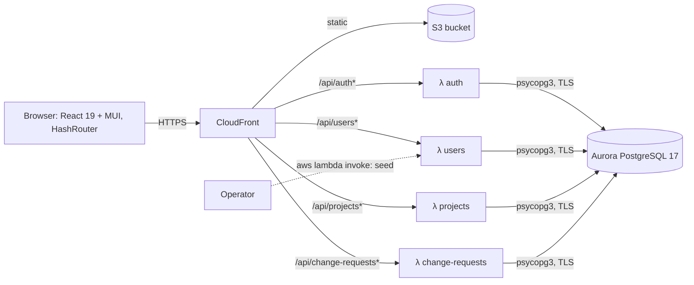

# Beacon — Portfolio Health

Beacon gives ACME Enterprise Technology's Portfolio Management Office and leadership **one trusted, current
view of project health**, people allocation, deliverables and budget. Health is **calculated from data by
transparent, configurable rules** (never chosen by the project manager), and every status explains itself,
for example: *"Amber. Budget: spend is 14% ahead of plan. Milestones: 'UAT sign-off' is due in 3 days and 40% complete."*

**Live:** https://d1u6z5us0d06jy.cloudfront.net

## Demo accounts

Demo data only. The passwords satisfy the policy (12+ characters, upper, lower, digit, symbol).

| Role | Email | Password | Lands on |
|---|---|---|---|
| Admin | admin@acme.example | `Beacon!Admin2026` | User management |
| Portfolio Manager (PMO) | pmo@acme.example | `Beacon!Pmo2026` | Portfolio / attention queue |
| Project Manager | pm@acme.example | `Beacon!Pm2026x` | My work: approvals waiting, my projects |
| PM Analyst | analyst1@acme.example | `Beacon!Analyst2026` | My proposals |
| PM Analyst | analyst2@acme.example | `Beacon!Analyst2027` | My proposals |
| Executive | exec@acme.example | `Beacon!Exec2026` | Portfolio (dashboard in a later slice) |

Five failed sign-ins lock an account for 15 minutes; the Admin can unlock it.

**Demo story in the data:** *Customer Portal Rebuild* (the PM reports Green, but the data says Red, so it shows
Status mismatch), *Data Lake Modernisation* (spending ahead of delivery), *Payments Gateway Upgrade* (two late
milestones), *Branch Network Refresh* (no status update for 12 days), and Priya Raman (allocated 58 h/week).
Jordan Lee (PM) has PM Analyst proposals waiting for approval.

## Architecture



- **Backend:** Python 3.13 Lambdas, one per domain. Each is layered handler → service → repository, on a shared
  library (`backend/_shared/beacon`) covering the DB connection, router, auth, RBAC, validation, audit,
  idempotency, the health engine, migrations and the seed. The library is synced into each service and
  committed (see docs/DECISIONS.md ADR-002).
- **Security:** PBKDF2-SHA256 (600k iterations) passwords, 30-minute JWT sessions renewed while active,
  lockout, a role × action permission map enforced on every request, and ownership checks in services.
- **Data:** versioned migrations run automatically on Lambda cold start; an idempotent seed runs by direct IAM invoke.

## Run, test, deploy

```sh
source ~/.bashrc
./bin/start-dev.sh                              # local: Postgres, LocalStack, Lambdas, proxy :3001, UI :3000

python3.13 -m venv .venv && .venv/bin/pip install -r backend/requirements-dev.txt
(cd backend && ../.venv/bin/pytest --cov=_shared/beacon --cov=auth --cov=users --cov=projects --cov=change-requests)
(cd frontend && npm test && npm run lint)

./bin/deploy.sh aws                             # sync shared lib, deploy backend, then frontend
source ENVIRONMENT.config && aws lambda invoke --function-name coding-workshop-users-e2540683 \
  --cli-binary-format raw-in-base64-out --cli-read-timeout 300 --payload '{"action":"seed"}' /tmp/seed.json
./scripts/smoke.sh https://d1u6z5us0d06jy.cloudfront.net    # signs in as every role, checks access control
```

## Documentation

- [docs/PLAN.md](docs/PLAN.md): delivery plan, scope, architecture, data model, health rules
- [docs/DECISIONS.md](docs/DECISIONS.md): ADRs and every business rule (CONFIRMED / ASSUMPTION)
- [docs/PROGRESS.md](docs/PROGRESS.md): done, next, risks
- [CLAUDE.md](CLAUDE.md): commands and gotchas for engineers
- Workshop guides: [docs/README.md](docs/README.md)

## License

MIT-0. See [LICENSE](LICENSE).
