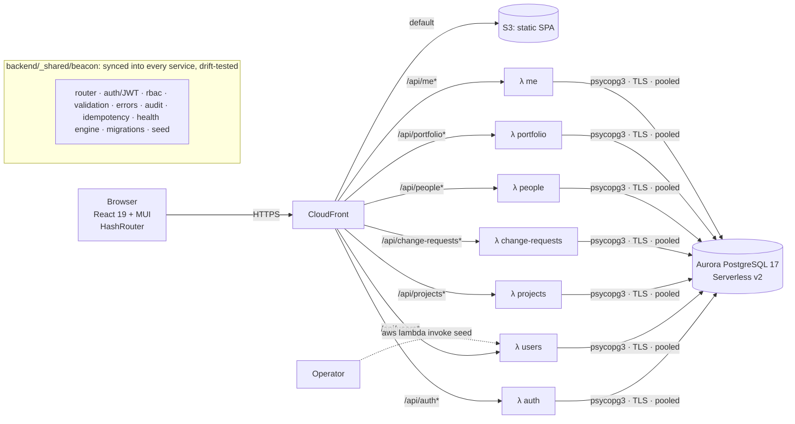
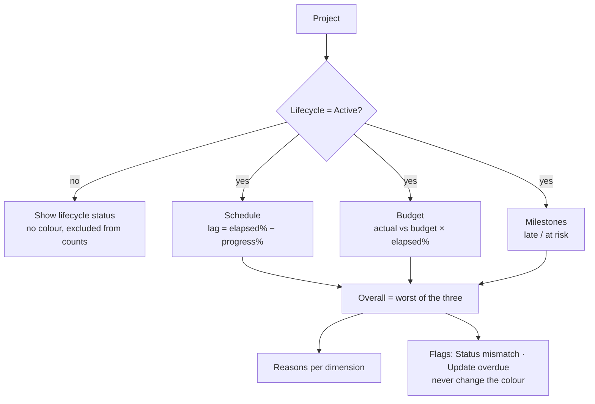

# Beacon — Design (as built, 2026-11-19)

This document describes what is **actually built and deployed** at https://d1u6z5us0d06jy.cloudfront.net,
not the original plan. Business-rule status (CONFIRMED / lead decision / assumption) is in
[DECISIONS.md](DECISIONS.md); test evidence is in [TESTING.md](TESTING.md).

## 1. Problem and goals
ACME's project status lives in decks, spreadsheets and emails in different formats, so steering committees argue
about whose numbers are right, and projects show Green until the week they go Red. Beacon gives the PMO and
leadership one current view where **health is calculated from data by transparent, configurable rules and always
explains itself**, so that risk shows up early enough to act on.

Goals and how the build meets them:

| Goal | As built |
|---|---|
| Every Active project has a calculated, explained status | Pure health engine; reasons on every project; nobody can override it |
| Risks surface before Red | "Your next actions" queue per role: at-risk milestones, mismatches, overdue updates, over-allocation, missing spend |
| One view for the steering committee | Executive home: off-track queue, then health by department, people load and budget against plan |
| PMs keep projects current quickly | Weekly status form, inline milestone and task edits, approvals inline |

## 2. Roles and permissions (enforced by the backend on every request)

| Capability | Admin | Portfolio Mgr | Project Mgr | PM Analyst | Executive |
|---|---|---|---|---|---|
| Users, roles, reset, unlock; access audit | ✔ | – | – | – | – |
| View portfolio, projects, people, dashboard | **403** | all | all (read) | assigned projects only | all (read) |
| Create project, assign PM, archive, cancel | – | ✔ | – | – | – |
| Change lifecycle status | – | ✔ | – | – | – |
| Rebaseline dates and budget (reason required) | – | ✔ | – | – | – |
| Edit project details, actual start | – | ✔ | own projects | – | – |
| Milestones, tasks, allocations | – | ✔ | own projects | **propose only** | – |
| Record weekly spend | – | ✔ | – | – | – |
| Weekly status update | – | – | own projects | – | – |
| Approve or reject analyst proposals | – | – | own projects | – | – |
| Project audit log | – | ✔ | own projects | – | – |
| Override health | – | – | – | – | – |

The rules live in **one declarative role × action map** (`backend/_shared/beacon/rbac.py`). Ownership (a PM manages
the project; an analyst is assigned to it) is checked in the service layer (`beacon/project_access.py`).
Responses are 401 when not signed in and 403 when not allowed.

> **Pending stakeholder change (CONFIRMED, not yet implemented):** PMs may edit **any** project, including the
> deadline and budget, with a mandatory reason and extra audit and queue safeguards. Approvals and status updates stay
> with the assigned PM. See DECISIONS.md Part C.

## 3. Architecture



- **One Lambda per domain** (Python 3.13). Each is layered: `function.py` (routes) → `*_service.py` (rules,
  ownership) → `*_repository.py` (parameterised SQL). CloudFront sends `/api/<first segment>*` to the Lambda of
  that name, which is why the queue lives in a `me` service (ADR-015).
- **Migrations** are versioned SQL files applied on cold start under an advisory lock. The **seed** is versioned
  and idempotent, run only by direct IAM invoke.
- **One database transaction per request**, so the change, its audit row, the health recalculation and the
  idempotency record commit together.

## 4. Data model (real tables)

```mermaid
erDiagram
  departments ||--o{ projects : owns
  departments ||--o{ people : employs
  users ||--o| people : "is (optional)"
  users ||--o{ projects : "PM of"
  projects ||--o{ milestones : has
  milestones ||--o{ tasks : has
  people ||--o{ tasks : assigned
  projects ||--o{ allocations : has
  people ||--o{ allocations : has
  projects ||--o{ spend_entries : "weekly spend"
  projects ||--o{ status_updates : has
  projects ||--o{ health_snapshots : history
  projects ||--o{ project_rebaselines : history
  projects ||--o{ project_analysts : staffs
  users ||--o{ project_analysts : "analyst"
  projects ||--o{ change_requests : has
  users ||--o{ change_requests : proposes
  users ||--o{ audit_log : acts
  users ||--o{ idempotency_keys : sends
  projects { uuid id PK; text name UK; text lifecycle_status; text priority; date planned_start; date planned_end; date actual_start; numeric approved_budget; date original_planned_start; date original_planned_end; numeric original_approved_budget; text health_overall; jsonb health_detail; text_arr health_flags; date health_as_of; timestamptz archived_at; int version }
  milestones { uuid id PK; uuid project_id FK; text name; date due_date; text status; int percent_complete; text notes; timestamptz deleted_at; timestamptz archived_at; int version }
  tasks { uuid id PK; uuid project_id FK; uuid milestone_id FK; text title; text status; uuid assignee_person_id FK; date due_date; int version }
  allocations { uuid id PK; uuid person_id FK; uuid project_id FK; numeric hours_per_week; date start_date; date end_date; timestamptz archived_at; int version }
  spend_entries { uuid id PK; uuid project_id FK; date week_starting "Monday"; text category; numeric amount; text note }
  status_updates { uuid id PK; uuid project_id FK; uuid author_user_id FK; text reported_status; text summary }
  change_requests { uuid id PK; uuid project_id FK; uuid proposer_user_id FK; text entity_type; uuid entity_id; int base_version; jsonb changes; text status; uuid decided_by FK; text reason }
  users { uuid id PK; text email UK; text role; text password_hash; bool must_change_password; int failed_attempts; timestamptz locked_until; int token_epoch; timestamptz previous_login_at; int version }
  audit_log { bigint id PK; uuid actor_user_id FK; text entity_type; uuid entity_id; uuid project_id; text action; jsonb before; jsonb after; text request_id }
  health_rules { text key PK; text category; numeric value; bool confirmed }
```

Also: `people`, `departments` (8, editable), `project_analysts`, `project_rebaselines` (reason, before, after),
`health_snapshots`, `idempotency_keys`, `app_secret`, `schema_migrations`, `seed_runs`.

The database enforces FKs, NOT NULL and CHECK constraints: enums, budget > 0, end after start, hours
0.5–168, Monday weeks, a reason on rejection. A unique index allows one live spend entry per project, week and
category. Nothing is hard-deleted: soft delete or archive only.

## 5. Health engine
`evaluate_health(project, milestones, tasks, spend_entries, status_updates, rules, today)` is a **pure function**.
It sees approved data only, and thresholds come from `health_rules`.



| Dimension | Amber | Red | Status |
|---|---|---|---|
| Schedule | progress trails elapsed by > 10 pts; *late start > 7 days* | > 25 pts, or past planned end and not complete | CONFIRMED (*late start: assumption*) |
| Budget | actual > planned to date by > 10%; *% spent − progress% > 15 pts* | > 20% over, or over the approved budget | CONFIRMED (*spend-ahead: assumption*) |
| Milestones | any at risk (due ≤ 7 days and < 75%) or 1 late | ≥ 2 late, or any > 14 days late | CONFIRMED |
| Overall | worst of the three | | CONFIRMED |
| Flags | Status mismatch (PM's reported status better than calculated); Update overdue (> 7 days) | | CONFIRMED |

Progress is the average milestone completion: the share of tasks done, or the PM's percentage when a milestone has
no tasks. Health is recalculated in the same transaction as any input change, refreshed lazily when the stored
date is older than today, and snapshotted whenever the result changes.

## 6. "Your next actions" ranking
`rank_work_items(items, today)` is pure and table-tested:
- **Base score:** critical 100, high 60, due_soon 30.
- **Days:** +1 per day overdue or waiting, capped at 30.
- **Priority:** +15 for a High-priority project, +5 for Medium.
- **Ties:** larger budget first, then earlier due date.

Sources per role:
- **PM:** own projects Red or mismatched, updates overdue or due, late or at-risk milestones, approvals waiting,
  people over 40 h.
- **PMO:** Red projects, mismatches, people over 60 h, no update for 14+ days, missing weekly spend (1 week = High,
  2+ = Critical), Proposed past start, Active with no allocations.
- **Executive:** Red projects, turned Red in the last 7 days, mismatches.
- **Analyst:** rework needed, own late or due tasks, pending proposals.
- **Admin:** locked accounts, temporary passwords, recent role changes.

## 7. Analyst approval and audit flow

```mermaid
sequenceDiagram
  actor A as PM Analyst
  participant P as λ projects
  participant C as λ change-requests
  participant DB as Aurora
  actor M as Project's PM
  A->>P: POST /projects/{id}/change-requests {changes}
  P->>DB: validate (same rules as direct edits); store PENDING + base_version; audit PROPOSED
  Note over DB: milestones/tasks untouched → health unchanged
  M->>C: GET /change-requests?view=approvals (or the queue)
  M->>C: POST /change-requests/{id}/approve
  C->>DB: lock request + target row (one transaction)
  alt target version ≠ base_version
    C-->>M: 409 (record changed since the proposal)
  else unchanged
    C->>DB: apply via beacon.plan, audit UPDATED_BY_APPROVAL (before/after) + APPROVED, recalculate health
    C-->>M: 200 APPROVED
  end
  M->>C: POST /change-requests/{id}/reject {reason}
  C->>DB: status REJECTED + reason; audit
```

Every write records an `audit_log` row in the same transaction: actor, entity, action, changed fields before and
after, and the request id. Secrets are redacted.

## 8. Security
- **Passwords:** PBKDF2-HMAC-SHA256, 600k iterations, random salt; the policy is 12+ characters with upper, lower,
  digit and symbol. The auth Lambda has one vCPU, so sign-in takes about 0.4 s.
- **Sessions:** 30-minute HS256 JWTs, renewed while the user is active. A per-user `token_epoch` revokes sessions on
  role change, reset or password change. The role is re-read from the database on every request.
- **Sign-in:** generic errors (no user enumeration, equal timing); lockout for 15 minutes after 5 failures; temporary
  passwords must be changed at the next sign-in.
- **Access:** authentication on every endpoint except sign-in; RBAC plus ownership checks on every request.
- **Data:** parameterised SQL with whitelisted sort and update columns; TLS to Aurora; no bodies or headers in logs.
- **Requests:** structured JSON logs (request id, user, role, route, status, duration); idempotent creates;
  optimistic concurrency (409 naming who changed the record).

## 9. API endpoints (all under `/api`, JSON, one error shape `{error:{code,message,details[]}}`)

| Service | Endpoints |
|---|---|
| auth | `POST /auth/login` · `POST /auth/refresh` · `GET /auth/me` · `POST /auth/change-password` |
| users | `GET/POST /users` · `GET/PUT /users/{id}` · `POST /users/{id}/reset-password` · `POST /users/{id}/unlock` · `GET /users/audit` |
| projects | `GET /projects/lookups` · `GET/POST /projects` (search, filters, sort incl. `attention`, pagination, `mine`) · `GET/PUT /projects/{id}` (rebaseline needs `rebaseline_reason`) · `POST /projects/{id}/archive` · `POST /projects/{id}/cancel` · `GET /projects/{id}/team` · `GET /projects/{id}/audit` |
| projects (nested) | `GET/POST …/milestones`, `PUT/DELETE …/milestones/{mid}` · `GET/POST …/tasks`, `PUT/DELETE …/tasks/{tid}` · `GET/POST …/allocations`, `PUT/DELETE …/allocations/{aid}` · `GET/POST …/spend` (upsert) · `GET/POST …/status-updates` · `GET/POST …/analysts`, `DELETE …/analysts/{uid}` · `POST …/change-requests` |
| change-requests | `GET /change-requests?view=approvals\|mine&status=` · `POST /change-requests/{id}/approve` · `POST /change-requests/{id}/reject` |
| people | `GET /people?q=&department_id=&load=UNDER\|OVER\|SEVERE` |
| portfolio | `GET /portfolio/summary?department_id=` |
| me | `GET /me/work-queue` |

## 10. Testing strategy
- **Backend:** 348 pytest tests, 97% coverage.
  - Table-driven boundary tests for the health engine, the ranking and the allocation rules.
  - Integration tests run the real Lambda handlers against a migrated and seeded local Postgres.
  - A role × endpoint access matrix; a drift test for the shared library.
- **Frontend:** 195 Vitest + React Testing Library tests with mocked APIs.
- **Deployed:** `scripts/smoke.sh` runs 58 checks against the live CloudFront URL after every deploy.
- Details and gaps are in [TESTING.md](TESTING.md).

## 11. Key decisions and trade-offs (full ADRs in DECISIONS.md)
- **Shared library synced into each service and committed**, with a drift test. The cost is duplicate files; the
  benefit is that the unchanged workshop deploy script works on its own (ADR-002).
- **Health is stored and also refreshed lazily**, so the portfolio can filter and paginate in SQL. The cost is a
  write on read once a day (ADR-007).
- **Proposals live in their own table**, so pending changes can never leak into health. A stale proposal must be
  re-proposed (ADR-012).
- **HashRouter**, because S3 with OAC returns 403 on deep links. URLs carry `#` (ADR-009).
- **JWT key in the database, not Secrets Manager**, to avoid an IAM change on the day. Recorded for production
  (ADR-004).
- **Isolated deploys from a worktree** when `main` held unreleased work (ADR-016).

## 12. Deliberate cuts
See [DECISIONS.md Part C](DECISIONS.md), with next steps:
- portfolio polish pass;
- budget-burn chart;
- health trends;
- one-minute session warning;
- `POST /users` idempotency;
- access-audit screen;
- original-baseline badge;
- spend-entry delete;
- and, after the 14:50 freeze, the stakeholder's PM edit-rights widening, the project History tab, and
  hours-as-percentage with the portfolio headcount.

## 13. Path to production
See [PRODUCTION-READINESS.md](PRODUCTION-READINESS.md):
- SSO;
- Secrets Manager with key rotation;
- per-environment accounts and a CI/CD pipeline with smoke-gated promotion;
- alarms and tracing;
- PITR and cross-region backups;
- RDS Proxy and provisioned concurrency for 500+ users;
- WAF and security headers;
- restricting Function URLs to CloudFront;
- a CSV migration path from today's spreadsheets.
