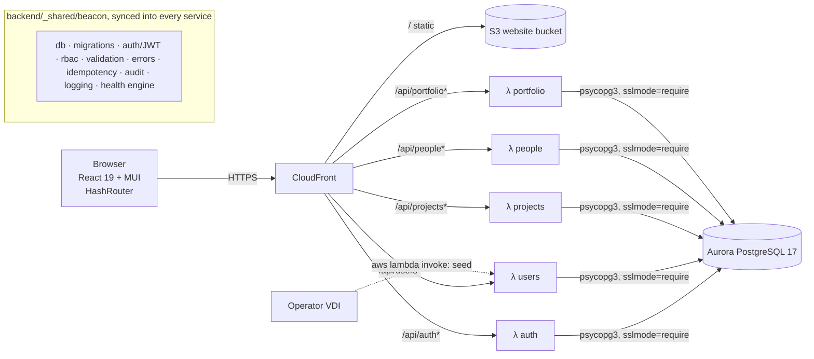

# Beacon — Delivery Plan

_Design checkpoint, 2026-11-19 (updated after Slice 1 with four stakeholder confirmations). Code freeze 16:00. Status key: ✅ CONFIRMED by Head of PMO · ⚠️ ASSUMPTION (to confirm today)._

## 1. Problem and success

Project status at ACME lives in decks, spreadsheets and emails in different formats, so steering committees
argue about numbers, and projects show green until the week they go red. Beacon replaces this with one current
view where **health is calculated from data by transparent rules and explains itself**, so risk shows up early
enough to act on.

| Success measure | How we'll show it |
|---|---|
| Every Active project has a calculated, explained status | Health badge with reasons on 100% of Active projects (seed data + test) |
| A PM completes a weekly update in < 2 min | Single-screen update form; timed walkthrough in the demo |
| Risk appears before Red | Amber reasons + attention queue (at-risk milestones, mismatches, overdue updates) |
| Steering works from one view | Executive dashboard + filtered portfolio list replace the deck |

## 2. Users and roles (enforced by the backend on every request)

| Capability | Admin | Portfolio Mgr | Project Mgr | Team member ⚠️ | Executive |
|---|---|---|---|---|---|
| Users, roles, password reset, unlock | ✅ | – | – | – | – |
| View portfolio / projects / dashboards | read-only ⚠️ | all | all ⚠️ (open: all vs own); edit own | own tasks only ⚠️ (role open) | all, read-only |
| Create project, baseline dates & budget, assign PM | – | ✅ | – (⚠️ can't move baselines) | – | – |
| Archive / cancel project | – | ✅ | – | – | – |
| Edit project; CRUD milestones & tasks | – | ✅ | own | – | – |
| Allocate people | – | ✅ | own | – | – |
| Record actual spend ✅ | – | ✅ | – (403) | – | – |
| Weekly status update (at least weekly ✅) | – | – | own | – | – |
| Update status of own assigned tasks ⚠️ | – | – | ✅ | ✅ | – |
| Override health | – | – | – | – | – |
| Edit health thresholds ⚠️ | – | ✅ | – | – | – |
| Audit log | ✅ | ✅ | own projects | – | – |

One declarative `role × action` map in the shared library; ownership checks (PM ↔ own project, member ↔ own task)
in the service layer. 401 = not signed in, 403 = not allowed.

## 3. Scope

**In (MVP, section 9 of the brief):** sign-in and security rules, Admin user management, RBAC · PMO project creation,
PM assignment, archive/cancel · PM self-service (details, milestones, tasks, allocations, spend, weekly update) ·
health engine with reasons, mismatch/overdue flags and snapshots · allocation rules and people view ·
portfolio list (search/filter/sort/paginate) and dashboards, role-aware home pages · audit log, idempotent creates,
409 on stale edits · tests for rules and RBAC · deployed and smoke-tested on AWS.

**Out:** SSO, integrations (HR/finance), offline mode, email notifications, hard deletes, multi-currency,
the threshold-editing *screen* (rules are editable in the DB/API; the screen is stretch #4).

**Cut list (drop in this order if behind):**
1. Stretch goals (all)
2. Under-allocation chart on the dashboard (keep the over-allocation list)
3. Budget burn chart (keep the per-project numbers); it sits below the queue and department view on the executive home
4. Mobile card variants beyond the portfolio list (tables scroll horizontally instead)
5. Health snapshot history UI (keep writing snapshots)
6. Token auto-renew warning dialog (keep hard 30-min expiry → redirect to sign-in)
7. Audit log *viewer* (keep writing audit rows; API only)

Never cut: calculated health with reasons, RBAC on every endpoint, password/lockout rules, tests, cloud deploy,
and (CONFIRMED) the executive home's "Needs attention" queue with Red projects at the top and health by department.

## 4. Architecture



Each Lambda: `function.py` (router + handlers) → `service.py` (rules, ownership) → `repository.py` (SQL).
Migrations run automatically on cold start (versioned, `pg_advisory_lock`, idempotent). Seeding runs via direct IAM
invoke (not exposed over HTTP) and is idempotent.

| Service | Endpoints |
|---|---|
| **auth** | `POST /api/auth/login` · `POST /api/auth/refresh` · `POST /api/auth/change-password` · `GET /api/auth/me` |
| **users** (Admin) | `GET/POST /api/users` · `GET/PUT /api/users/{id}` · `POST /api/users/{id}/reset-password` · `POST /api/users/{id}/unlock` |
| **projects** | `GET /api/projects/lookups` (departments, PMs) · `GET/POST /api/projects` · `GET/PUT /api/projects/{id}` · `POST /api/projects/{id}/archive` · `/cancel` · `GET /api/projects/{id}/health` (current + history) · `GET /api/projects/{id}/audit` |
| projects (nested) | `GET/POST /api/projects/{id}/milestones`, `PUT/DELETE …/milestones/{mid}` · same for `tasks`, `allocations`, `spend` · `GET/POST …/status-updates` · `PATCH …/tasks/{tid}/status` (assignee) |
| **people** | `GET /api/people` (search, over/under-allocated filters) · `GET /api/people/{id}` (allocations) · `GET /api/people/me/tasks` |
| **portfolio** | `GET /api/portfolio/summary` (dashboard) · `GET /api/portfolio/attention` · `GET /api/portfolio/audit` · `GET/PUT /api/portfolio/health-rules` |

All list endpoints: `?q=&page=&page_size=&sort=` + filters. All creates accept `Idempotency-Key`. All updates carry `version`.

## 5. Data model

```mermaid
erDiagram
  users ||--o| people : "may be"
  users ||--o{ projects : "manages (pm_user_id)"
  departments ||--o{ projects : owns
  departments ||--o{ people : employs
  projects ||--o{ milestones : has
  milestones ||--o{ tasks : has
  people ||--o{ tasks : "assigned"
  projects ||--o{ allocations : has
  people ||--o{ allocations : has
  projects ||--o{ spend_entries : has
  projects ||--o{ status_updates : has
  projects ||--o{ health_snapshots : has
  users ||--o{ audit_log : "acted"
  users { uuid id PK; text email UK; text role; text password_hash; bool must_change_password; int failed_attempts; timestamptz locked_until; int token_epoch; int version }
  projects { uuid id PK; text name UK; uuid department_id FK; uuid pm_user_id FK; date planned_start; date planned_end; date actual_start; numeric approved_budget; text lifecycle_status; text priority; text health_overall; jsonb health_detail; date health_as_of; bool archived; int version }
  milestones { uuid id PK; uuid project_id FK; text name; date due_date; text status; int percent_complete; bool deleted; int version }
  tasks { uuid id PK; uuid milestone_id FK; text title; text status; uuid assignee_person_id FK; date due_date; bool deleted; int version }
  allocations { uuid id PK; uuid person_id FK; uuid project_id FK; numeric hours_per_week; date start_date; date end_date; bool archived; int version }
  spend_entries { uuid id PK; uuid project_id FK; date spent_on; numeric amount; text category; text note }
  status_updates { uuid id PK; uuid project_id FK; uuid author_id FK; text reported_status; text summary; timestamptz created_at }
  health_snapshots { uuid id PK; uuid project_id FK; text overall; jsonb dimensions; jsonb reasons; timestamptz taken_at }
  health_rules { text key PK; numeric value; text description; bool confirmed }
  audit_log { bigint id PK; uuid actor_id FK; text entity_type; uuid entity_id; uuid project_id; text action; jsonb before; jsonb after; text request_id; timestamptz at }
  idempotency_keys { uuid user_id PK; text key PK; text request_hash; int status_code; jsonb response; timestamptz created_at }
```

DB enforces FKs, NOT NULL, CHECKs (enums, budget > 0, end > start, 0.5 ≤ hours ≤ 60) and indexes every filter/join column.

## 6. Health rules (all values in `health_rules`, editable by PMO)

| Dimension | Amber | Red | Status |
|---|---|---|---|
| Scope | Only `Active` projects get health; others show lifecycle status | | ⚠️ |
| **Schedule** (elapsed% = days since planned start ÷ planned duration; progress% = avg milestone completion) | progress lags elapsed by **> 10 pts**, or actual start **> 7 days** after planned | lag **> 25 pts**, or planned end passed and not complete | dimension ✅, thresholds ⚠️ |
| **Budget** (planned-to-date = budget × elapsed%) | actual > planned-to-date by **> 10%**, or %budget spent > progress% by **> 15 pts** | actual > planned-to-date by **> 20%**, or > total budget | dimension ✅, thresholds ⚠️ |
| **Milestones** (At risk = due ≤ **7 days** and < **75%**; Late = past due, not complete) | any at risk, or **1** late | **≥ 2** late, or any > **14 days** late | dimension ✅, thresholds ⚠️ |
| **Overall** | worst of the three | | ✅ |
| No override by anyone | | | ✅ |
| Flag "Status mismatch": PM's reported status better than calculated | | | ⚠️ |
| Flag "Update overdue": PMs update at least weekly; none in **7 days** raises the flag (colour unchanged) | | | ✅ |
| Snapshot stored whenever inputs change | | | ✅ |

The engine is a pure function `evaluate_health(project, milestones, tasks, spend_entries, status_updates, rules, today)`
→ `{overall, dimensions, reasons[], flags[]}`. It is recomputed in the same transaction as any input change, and lazily
re-evaluated when `health_as_of < today` (time alone moves elapsed%).

## 7. Delivery slices (each: DB → API → UI → tests → local green → commit → deploy)

| Slice | Target | Content |
|---|---|---|
| 0 Foundations | 11:00 | Shared library + sync, migrations runner, error/logging/router, test harness (pytest + Vitest), MUI shell, API client |
| **1** ✔ | **12:00 deployed** (done) | Schema + seed (120 projects, 150 people, demo accounts) · sign-in, password policy, lockout, 30-min JWT + renew · RBAC map · Admin user list · read-only portfolio list from Aurora · smoke script green on AWS |
| 2 | 13:00 | PMO create/assign/archive/cancel (cascade) · PM milestones, tasks, weekly updates · audit log · idempotency · 409 conflicts |
| 3 | 13:45 | Health engine + table-driven tests · reasons UI badge · mismatch/overdue flags · snapshots |
| 4 | 14:30 | Allocations (40 h amber / 60 h reject, lifecycle rules) · spend entries (**PMO only** ✅; PM gets 403, no spend editing in PM UI) · people view |
| 5 | 15:00 | Executive home **opens with the "Needs attention" queue, Red projects at the top** ✅, then health by department, then the other charts · PMO attention queue · role-aware home pages (portfolio search/filters already done in Slice 1) |
| Freeze | 15:00–16:00 | Hardening, coverage, 375 px check, final deploy, smoke test on AWS, docs, push |

## 8. Top risks

| Risk (found in Phase 0) | Mitigation |
|---|---|
| Local proxy strips `Authorization`, so auth can't work locally | **Approve 2-line fix** to `bin/proxy-server.js` (forward `authorization`, `idempotency-key`); cloud already works |
| Code outside a service folder isn't packaged | Canonical `backend/_shared/beacon` + sync into each service (**approve `bin/sync-shared.sh`**); CI test fails on drift |
| PBKDF2 600k = **4 s** per sign-in at 128 MB | Accept for MVP, or **approve raising auth Lambda memory** (Terraform) → ~0.3 s |
| Aurora auto-pause + cold start = 16 s; CloudFront 504 at 30 s | Bounded connect retry; UI retries once on 503/504; warm the DB before the demo |
| `start-dev.sh` uses pip 3.14 → wrong psycopg wheel locally (unverified) | Verify on first local run; fix = `python3.13 -m pip` (bin/ change, ask) |
| Health drifts with the calendar, not just with edits | Lazy recompute when `health_as_of < today` on read |
| No GitHub creds on VDI | You push with `! git push`; commit often locally |
| Scope vs 5 hours | Slice 1 deployed by 12:00; strict cut list |
| AI stretch: Lambda has no route to Bedrock | Template fallback only unless infra adds a VPC endpoint (ask) |

## 9. Open questions for the stakeholder

Confirmed on 2026-11-19: overall = worst dimension · weekly updates (7-day overdue flag) · spend recorded by the PMO
only · executive home leads with the attention queue and Red projects.

**Top 5 now** (full ranked list of 17 in docs/DECISIONS.md):
1. The exact health thresholds (every value in §6)
2. 60 h/week: hard reject, or allowed with a warning?
3. Can PMs see all projects, or only their own?
4. Team member role: do assignees sign in and update their own task status?
5. Who can re-baseline dates and approved budget (PMO only)?
